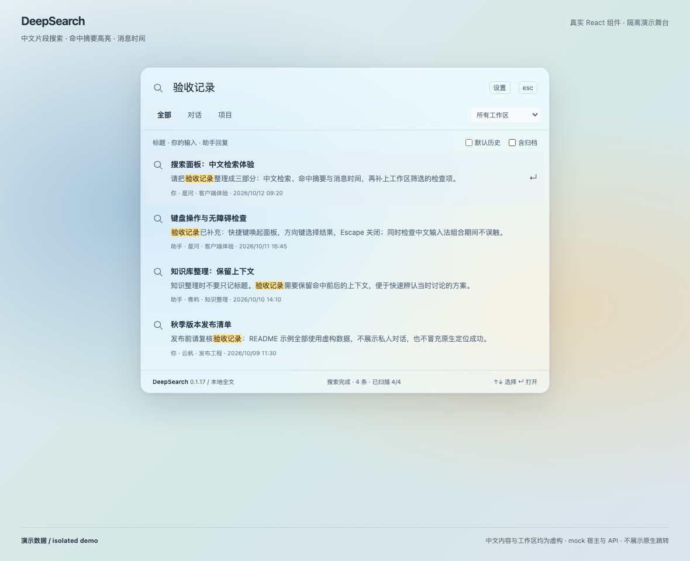
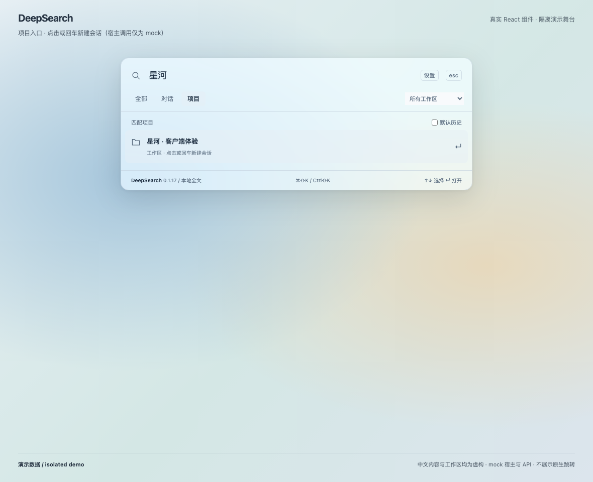
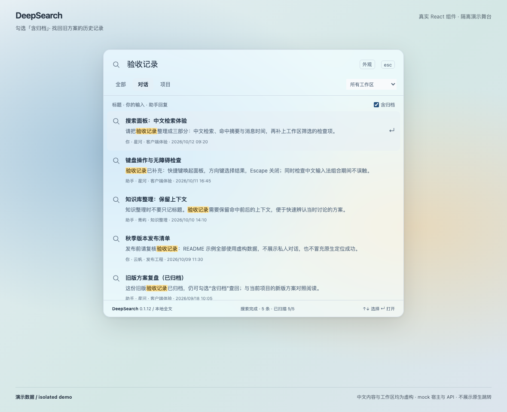
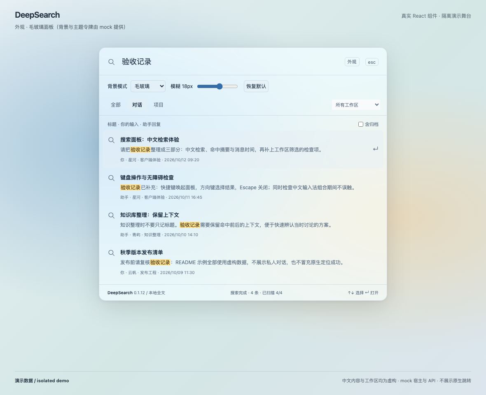
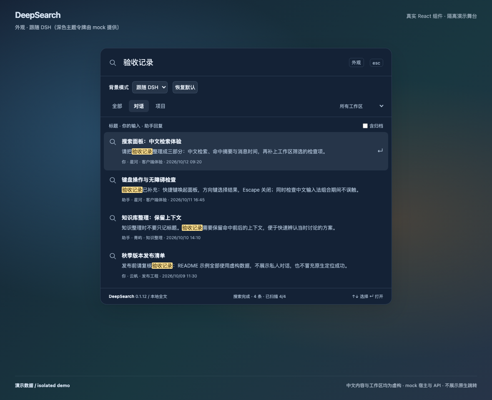
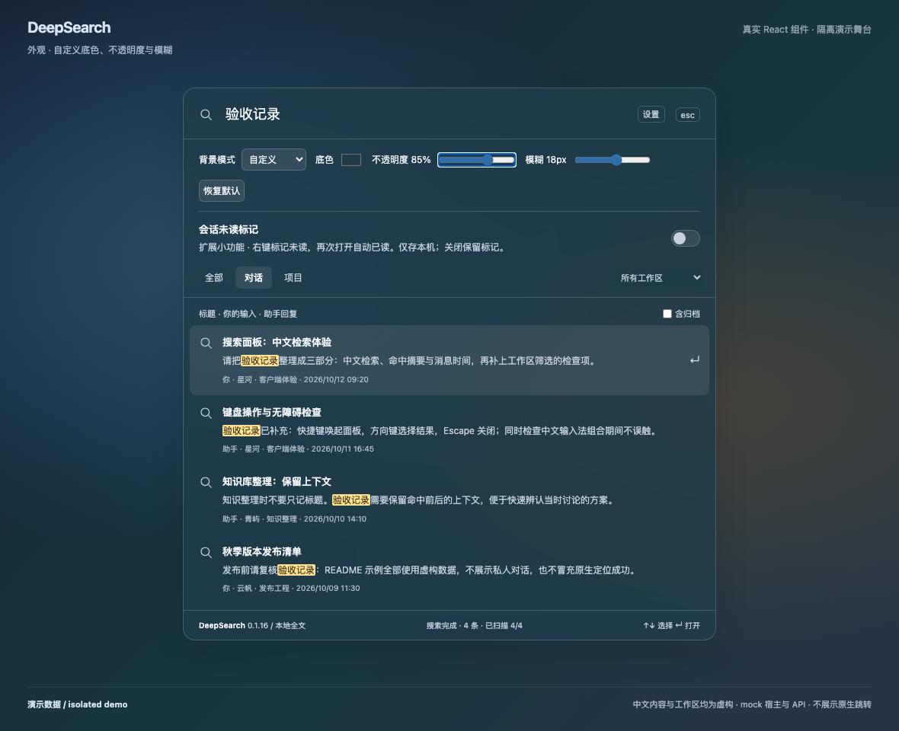

# DeepSearch · Full-text Conversation Search

[简体中文](README.md) | **English**

A local full-text search plugin for **DeepSeek Harness**. Find a conversation from a fragment you remember, without having to remember its title.

- **Search Chinese fragments**: literal substring matching without FTS tokenization, case-insensitive English matching, and literal punctuation.
- **Search message content**: conversation titles, user messages, and completed final assistant replies. Results show highlighted snippets and the message's local date and time.
- **Current conversation first**: search its newest messages first, then automatically scan the remaining conversations in batches.
- **Native conversation navigation**: open the original DSH conversation, load the exact message, and attempt to scroll to and highlight it—without replacing the conversation view.
- **Scope and appearance controls**: project/workspace filters, optional archived conversations, frosted glass, host theme, and custom color, opacity, and blur.
- **No chat uploads**: reuse the host's authentication and history services, with no additional production listener or changes to your messages.

## Feature Preview

These images use the **actual plugin components in an isolated mock host with fictional demo data**. They are not screenshots of your chats or the native DSH conversation page. Native message navigation must be verified in the real host; the demo does not simulate successful navigation. The screenshots show the Chinese UI; this English README does not change the plugin's interface language.

### Full-text search, highlighted snippets, and message timestamps



### Project and workspace filters



### Archived conversations



### Three panel appearance modes







## Installation

The verified host is **DSH Desktop 0.2.2-rc.3**. Other versions and platforms have not completed real-desktop regression testing. The package's compatibility range is currently restricted to this host version.

### Install from npm (recommended)

The public package is [@renyuluo/dsh-deepsearch](https://www.npmjs.com/package/@renyuluo/dsh-deepsearch), currently **0.1.13**. Registry availability, package integrity, and installation in a clean directory have been verified.

```sh
dsh plugin --profile desktop add @renyuluo/dsh-deepsearch
```

The public package name is **`@renyuluo/dsh-deepsearch`**. The product name and GitHub repository name remain unchanged.

### Install from GitHub

```sh
dsh plugin --profile desktop add 'https://github.com/luorenyu/dsh-deepsearch.git#v0.1.13'
```

Alternatively, download the package from [Releases](https://github.com/luorenyu/dsh-deepsearch/releases), then install it:

```sh
dsh plugin --profile desktop add /path/to/renyuluo-dsh-deepsearch-0.1.13.tgz
```

> **Important: do not install the unscoped npm package with `add dsh-deepsearch`.** That package belongs to another author and is unrelated to this repository. Use `@renyuluo/dsh-deepsearch` or this repository's GitHub/Release URL instead.

If you previously installed this project under its old unscoped name from GitHub, remove that entry before installing the scoped package so that two copies do not load at once:

```sh
dsh plugin --profile desktop remove dsh-deepsearch
dsh plugin --profile desktop add @renyuluo/dsh-deepsearch
```

This migration applies only to this project's old installation; it is not a recommendation to remove another author's similarly named plugin. The appearance storage key is unchanged, so existing preferences are preserved on the same host page origin.

The feature screenshots above were captured with the 0.1.12 demo components. Version 0.1.13 changes only the distribution identity, not search behavior.

### Discover it in the DSH plugin marketplace

[Marketplace submission #15379](https://github.com/awesome-dsh-plugin/awesome-dsh-plugin/pull/15379) has been opened as a draft. It is awaiting the repository's 24-hour minimum age before being marked ready for maintainer review. [Awesome DSH Plugin](https://github.com/awesome-dsh-plugin/awesome-dsh-plugin) is the third-party community catalog used by `dshmarket`. Availability depends on the PR being merged and the marketplace being synchronized. **A GitHub release does not mean the plugin is already listed in the marketplace.**

Once accepted, search the relevant marketplace for **DeepSearch** or **会话全文搜索**. Check that the source is `luorenyu/dsh-deepsearch`, not another author's similarly named plugin. DSH also supports custom indexes, so catalog sources may differ between clients.

## Usage

| Action | Shortcut / control |
| --- | --- |
| Open or close search | macOS `⌘⇧K`; Windows/Linux `Ctrl⇧K` (not tested on physical devices) |
| Select a result | `↑` / `↓` |
| Open a result | `Enter` |
| Close the panel | `Esc` or click outside |
| Set the search scope | All / Conversations / Projects, workspace dropdown, include archived |
| Adjust the panel | “外观” (Appearance) in the upper-right corner |

DeepSearch does not take over DSH's native `⌘K` shortcut or the `⌘F` shortcut commonly used by other search plugins.

Enter a Chinese fragment or an English keyword. Search continues automatically, with results appearing as each batch is scanned—no manual paging is required. “No results” is shown only after a complete scan finds no matches. Read failures, timeouts, incomplete scans, and the 200-result limit are reported separately. Changing the query or closing the panel cancels the previous task.

Opening a message result takes you to the native conversation. The plugin verifies the exact message using `sessionId + seq`, then attempts to locate and highlight the corresponding native row. The status area lets you return to search or clear the highlight. Switching conversations or feature pages releases navigation resources. Title results only open the conversation; they do not claim successful message positioning.

## Appearance

- **Frosted glass**: prefer the host input field's glass background and blur only the area behind the search panel.
- **Follow DSH**: use an opaque background from the host theme.
- **Custom**: choose a color, opacity from 55–100%, and blur from 0–32px, or restore the defaults.

DeepSearch does not dim the screen or blur the entire DSH page. Its compatibility fix for wallpaper plugins' opaque-dialog rules applies only to its own panel. Preferences are saved locally in `localStorage`; if storage is blocked, settings remain usable for the current session. An opaque fallback is used when reduced transparency is requested or backdrop blur is unsupported.

## Privacy and Limitations

- Reads history through the host's public services, not by parsing private chat files directly. It does not upload chats or write to original messages. The search API uses the host's owner-authenticated `connection.fetch` routes.
- By default, searches regular conversation titles, user messages, and completed final assistant replies. Tool output, reasoning, subagents, and unfinished replies are excluded. Archived conversations are excluded unless enabled.
- Uses bounded memory, short-lived cursors, and batch scanning—**not a persistent incremental index**. Initial searches through very long histories may be slower. At most 200 results are displayed. Cursors expire after two minutes of inactivity, requiring a new search.
- Each conversation's history snapshot at its first read defines the scope of that scan. Messages appended during scanning appear only after a new search. History revisions or truncation explicitly require restarting the search.
- Projects come from workspaces registered with the host. DeepSearch **does not search file contents on disk** or provide command search.
- Message timestamps use the local time zone and the format `YYYY/MM/DD HH:mm`. Missing or invalid timestamps are not invented.
- Exact positioning uses a DOM compatibility adapter for the current host, not a stable public scrolling API. Folded messages, Markdown transformations, non-Chat views, host upgrades, or native scrolling policies may prevent positioning or exact-text highlighting. The plugin reports these states without blocking the native conversation.

## Development and Testing

No build step or third-party production dependencies are required. Use Node.js 22+:

```sh
git clone https://github.com/luorenyu/dsh-deepsearch.git
cd dsh-deepsearch
npm test
npm run check
npm pack --ignore-scripts
```

Core tests cover literal matching, Chinese and Unicode ranges, history projection, reverse pagination, automatic continuation, cancellation/timeouts/cursors, native navigation lifecycle, snippet rendering, timestamps, and appearance. Component screenshots and mock-service tests are not equivalent to real-host acceptance testing across every host version, theme, and platform.

Code overview:

- [client.js](client.js): search panel, shortcuts, snippets, appearance, and native navigation adapter.
- [host.js](host.js): authenticated routes and request limits.
- [search-core.js](search-core.js): conversation catalog, final-reply projection, substring matching, and pagination.
- [tests](tests): host-independent unit and contract regression tests.

Uninstall:

```sh
dsh plugin --profile desktop remove @renyuluo/dsh-deepsearch
```

[MIT License](LICENSE) · [Report an issue](https://github.com/luorenyu/dsh-deepsearch/issues)
