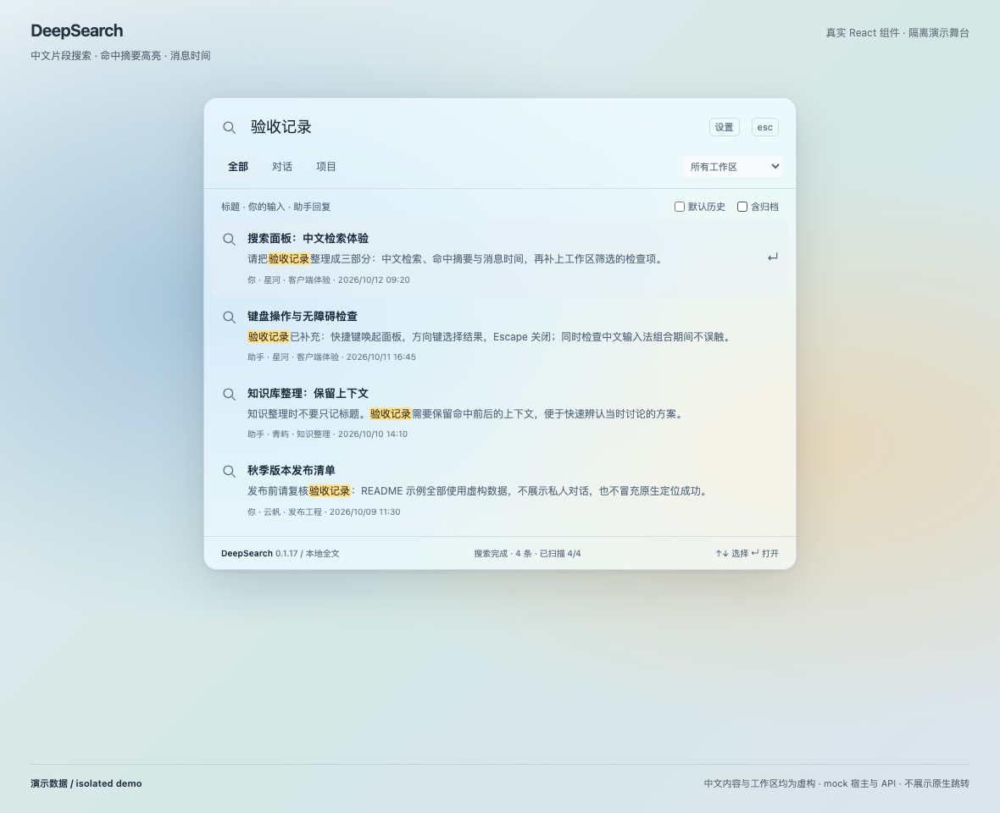
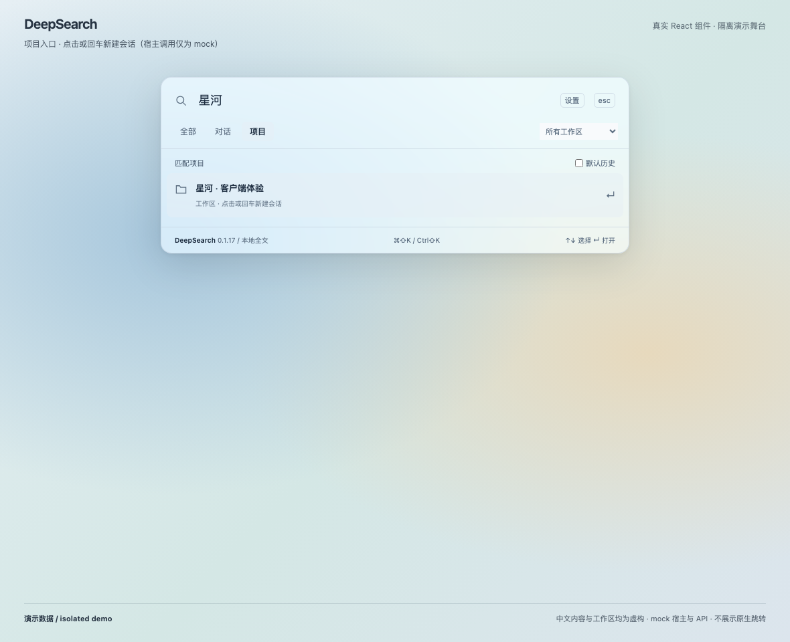
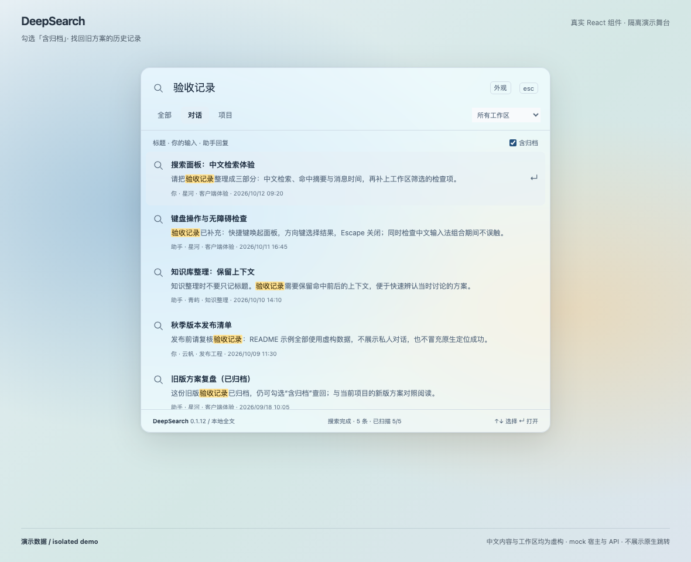
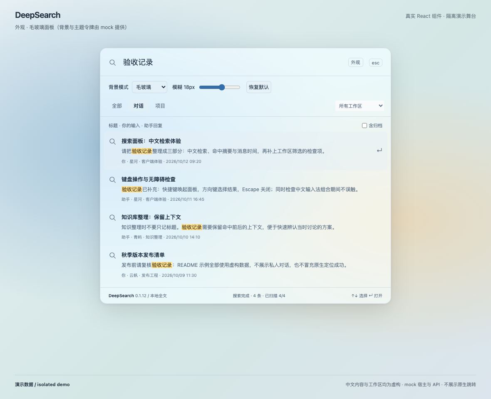
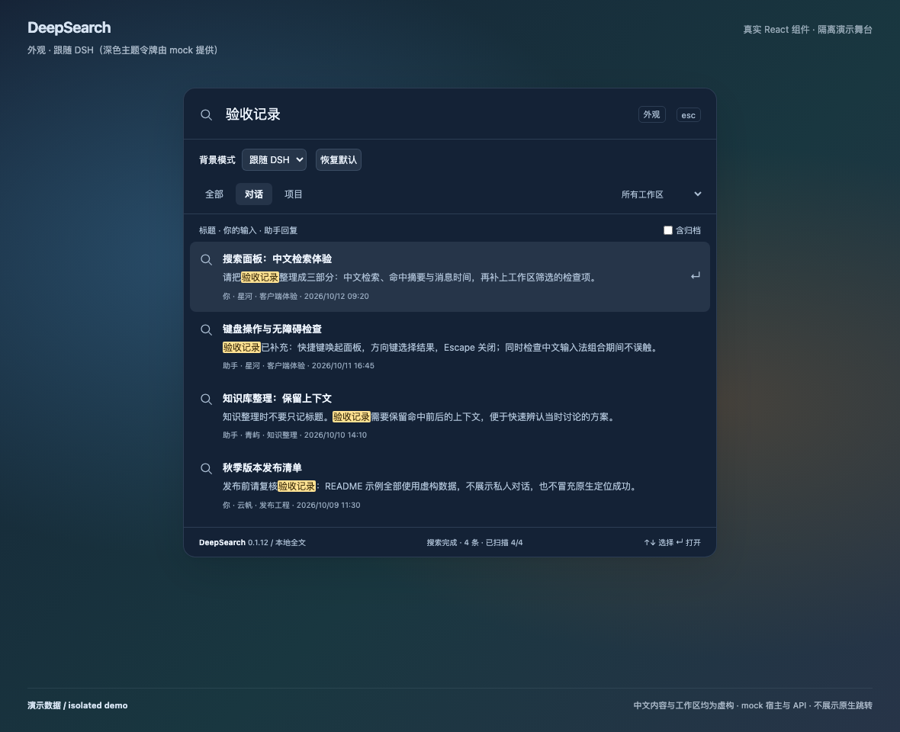
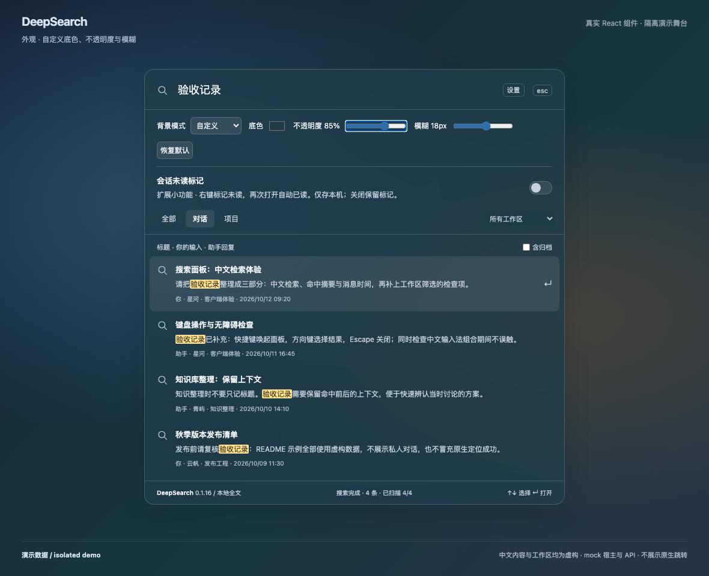

# DeepSearch · 会话全文搜索

**简体中文** | [English](README.en.md)

为 **DeepSeek Harness** 制作的本地全文搜索插件。记得一小段内容，就能找回对应会话，而不必记住标题。

- **中文片段也能搜**：不依赖 FTS 分词，支持连续中文子串、英文大小写不敏感和字面符号。
- **正文搜索**：会话标题、用户输入、助手已完成的最终回复；命中摘要直接高亮，展示消息的本地日期与时间。
- **当前会话优先**：先从当前会话最新消息往前搜索，再自动逐批扫描其他会话。
- **原生会话定位**：打开 DSH 原生会话，加载精确消息并尝试滚动、高亮，不替换详情页。
- **范围与外观**：项目 / 工作区过滤、可选归档；毛玻璃、跟随主题、自定义颜色、不透明度与模糊。
- **不上传聊天**：复用宿主认证与历史服务，不开额外生产监听端口，不修改消息；仅在你确认“恢复并打开”时取消归档。

## 功能预览

以下图片使用**真实插件组件 + 隔离模拟宿主 + 虚构演示数据**生成，并非你的聊天记录或 DSH 原生页面截图。原生消息跳转需在真实宿主中验证，演示页不模拟“定位成功”。

### 全文搜索、命中摘要与准确时间



### 项目与工作区范围



### 归档会话



### 三种面板外观







## 安装

当前验证宿主为 **DSH Desktop 0.2.2-rc.3**；其他版本与平台尚未完成真实桌面回归。包的兼容性范围暂时限定该版本。

### 从 npm 安装（推荐）

已公开发布 [@renyuluo/dsh-deepsearch](https://www.npmjs.com/package/@renyuluo/dsh-deepsearch)，当前版本 **0.1.13**。已验证 npm registry 查询、发布校验值及全新目录安装。

```sh
dsh plugin --profile desktop add @renyuluo/dsh-deepsearch
```

公开包名为 **`@renyuluo/dsh-deepsearch`**；产品名和 GitHub 仓库名不变。

### 从 GitHub 安装

```sh
dsh plugin --profile desktop add 'https://github.com/luorenyu/dsh-deepsearch.git#v0.1.13'
```

也可以从 [Releases](https://github.com/luorenyu/dsh-deepsearch/releases) 下载安装包后安装：

```sh
dsh plugin --profile desktop add /path/to/renyuluo-dsh-deepsearch-0.1.13.tgz
```

> **重要：不要运行 `add dsh-deepsearch` 来安装 npm 同名包。** 无作用域的 npm 同名包属于其他作者，与本仓库无关。请使用 `@renyuluo/dsh-deepsearch`，或本仓库 GitHub / Release 地址。

从本项目旧版无作用域 GitHub 安装迁移时，请先卸载旧条目，再安装作用域包，避免两份搜索插件同时加载：

```sh
dsh plugin --profile desktop remove dsh-deepsearch
dsh plugin --profile desktop add @renyuluo/dsh-deepsearch
```

这是替换本项目旧安装条目，不是建议卸载其他作者的同名插件。外观存储键保持不变；同一宿主页面来源下已有偏好会继续使用。

上方功能截图来自 0.1.12 演示组件；0.1.13 仅调整分发身份，不改变搜索功能。

### 在 DSH 插件市场中发现

已提交 [市场收录申请 #15379](https://github.com/awesome-dsh-plugin/awesome-dsh-plugin/pull/15379)，目前为草稿，等待仓库创建满 24 小时后转为正式待审及维护者审核。[Awesome DSH Plugin](https://github.com/awesome-dsh-plugin/awesome-dsh-plugin) 是 `dshmarket` 使用的第三方社区目录；是否收录以 PR 合并和市场同步为准。**GitHub 发布不等于已经在市场上架。**

审核通过后，可在相应市场搜索 **DeepSearch** 或 **会话全文搜索**。请确认来源是 `luorenyu/dsh-deepsearch`，不是其他作者的同名插件。DSH 本体也支持自定义索引，各客户端配置的来源可能不同。

## 使用

| 操作 | 快捷键 / 入口 |
| --- | --- |
| 打开或关闭搜索 | macOS `⌘⇧K`；Windows / Linux `Ctrl⇧K`（未实机验证） |
| 选择结果 | `↑` / `↓` |
| 打开结果 | `Enter` |
| 关闭浮层 | `Esc` 或点击外部 |
| 搜索范围 | 全部 / 对话 / 项目，工作区下拉，含归档 |
| 调整面板 | 右上角「外观」 |

不占用 DSH 原生 `⌘K`，也不占用其他搜索插件常用的 `⌘F`。

输入中文片段或英文关键词后，搜索自动继续，不需要逐页点击。结果随扫描逐步出现；只有扫描完成且没有命中才显示没有找到。读取失败、超时、未完成与 200 条结果上限会单独提示。切换关键词或关闭面板会取消旧任务。

点击正文结果后，插件打开原生会话，使用 `sessionId + seq` 检查精确消息是否存在，随后尝试定位原生行并高亮。提示区可以返回搜索或清除高亮；切换会话或其他功能页时释放定位资源。标题结果仅打开会话，不冒充消息定位成功。

### 打开归档结果

勾选“含归档”后，归档会话的标题与正文结果显示 **「已归档」** 标签。点击时保留搜索结果并请求确认；只有选择 **「恢复并打开」** 才调用宿主取消归档，然后进入原生会话并尝试定位。选择「取消」不会改变归档状态。

恢复失败或超时会保留结果并提示原因，不静默跳转，也不自动重新归档。恢复请求发出后不能保证撤回；关闭面板或更换查询只会取消后续自动跳转，宿主仍可能完成已确认的恢复操作。

## 外观

- **毛玻璃**：优先使用宿主输入框玻璃底色，仅对搜索面板覆盖区域模糊。
- **跟随 DSH**：使用宿主主题的实色底板。
- **自定义**：颜色、不透明度 55–100%、模糊 0–32px，可恢复默认。

不暗化全屏，不模糊整个 DSH 页面。兼容壁纸插件的实色弹窗覆盖规则，修正只作用于 DeepSearch 自己。偏好存于本机 `localStorage`；禁止存储时仍可在本次使用。系统要求降低透明度或不支持模糊时使用实色回退。

## 隐私与限制

- 通过宿主公开历史服务读取，不直接解析私有聊天文件，不上传聊天、不写入原始消息。搜索 API 使用宿主 `connection.fetch` owner 认证路由。
- 默认搜索普通会话标题、用户输入及已完成助手最终回复；排除工具输出、推理、子智能体与未完成回复。默认不含归档。
- 搜索采用有界内存、短期游标和逐批扫描，**不是持久增量索引**。超长历史首次查询可能较慢；最多显示 200 条命中，游标闲置两分钟过期后需重搜。
- 每个会话首次读取的历史切面构成本次范围；扫描期间新追加内容需要重新搜索才会出现。版本变更或历史截断会明确要求重新搜索。
- 项目来自宿主已登记工作区，**不搜索磁盘文件内容**，也不提供命令搜索。
- 消息时间按本机时区显示为 `YYYY/MM/DD HH:mm`，缺失或非法时间不编造。
- 精确定位使用当前宿主 DOM 兼容适配，并非公开稳定滚动 API。折叠消息、Markdown 文本变形、非 Chat 视图、宿主升级或滚动策略可能导致无法定位或逐字高亮，插件会区分状态，不阻塞原生会话。

## 开发与测试

无需构建和生产第三方依赖，Node.js 22+：

```sh
git clone https://github.com/luorenyu/dsh-deepsearch.git
cd dsh-deepsearch
npm test
npm run check
npm pack --ignore-scripts
```

核心测试覆盖字面匹配、中文与 Unicode 范围、历史投影、逆序分页、自动续搜、取消 / 超时 / 游标、原生定位生命周期、摘要渲染、时间和外观。组件截图和模拟服务测试不等于所有宿主版本、主题与平台实机验收。

代码分工：
- [client.js](client.js)：搜索浮层、快捷键、摘要、外观和原生定位适配。
- [host.js](host.js)：认证路由和请求限制。
- [search-core.js](search-core.js)：会话目录、最终回复投影、字串匹配和分页。
- [tests](tests)：无宿主单元 / 合约回归测试。

卸载：

```sh
dsh plugin --profile desktop remove @renyuluo/dsh-deepsearch
```

[MIT License](LICENSE) · [问题反馈](https://github.com/luorenyu/dsh-deepsearch/issues)
